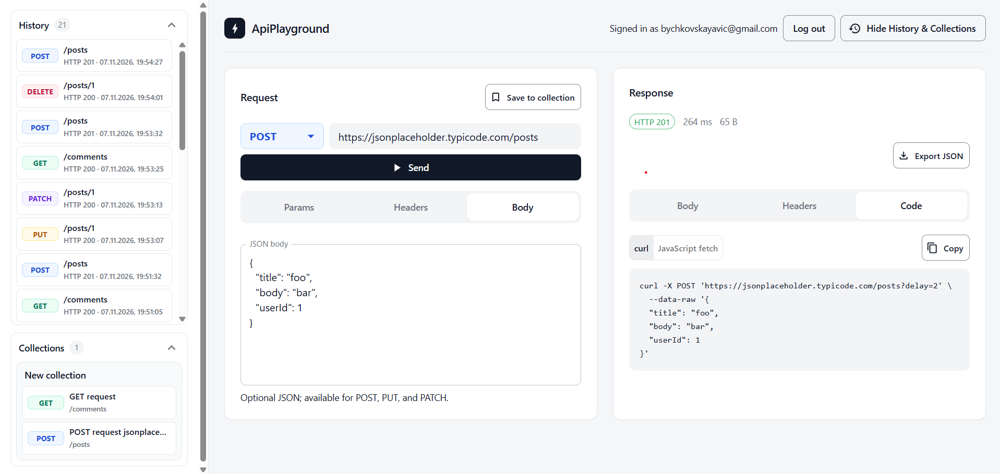

# ApiPlayground

A local-only HTTP request playground: send requests, inspect responses, keep history, and save request collections. It runs on your machine only.

## About

- **Frontend:** React 19, TypeScript, Vite, MobX, MUI. The UI sends requests only through the backend.
- **Backend:** ASP.NET Core on .NET 10, EF Core, PostgreSQL 17. Sign-up and login use a cookie session. Collections and history are per user.
- **Outbound requests:** go through one guarded path. Outside test mode, only public addresses are allowed.
- **Network:** the API binds to loopback (`localhost`) only. The backend checks the `Host` and `Origin` headers.
- **Layout:** `backend/src` holds Domain, Application, Infrastructure and Api. Dependencies point inward, and Api is the only composition root. `frontend/src` holds the UI and `frontend/e2e` holds browser tests. `_bmad/` and `_bmad-output/` belong to the BMAD process.

## Screenshot

<p align="center">
  
</p>

The request editor (method, URL, Params, Headers, Body) is on the left. The response panel with Body, Headers and Code tabs is on the right. History and Collections are in the sidebar.

## Requirements

- .NET 10 SDK
- Node.js 24 and npm
- PostgreSQL 17 installed locally (Docker is not required)

## Quick start

### 1. Database

Create the application role and database. Choose your own password:

```powershell
psql -U postgres -c "CREATE ROLE apiplayground LOGIN PASSWORD '<password>';"
createdb -U postgres -O apiplayground apiplayground
```

### 2. Connection string in user secrets

The database connection string is stored in the user secrets of `ApiPlayground.Api`, not in repository files. [.env.example](.env.example) shows the format, but the API does not read that file.

```powershell
dotnet user-secrets set "ConnectionStrings:Postgres" "Host=localhost;Port=5432;Database=apiplayground;Username=apiplayground;Password=<password>" --project backend/src/ApiPlayground.Api
```

ASP.NET Core loads user secrets automatically in the Development environment.

### 3. Dependencies and migrations

From the repository root:

```powershell
npm ci --prefix frontend
dotnet restore backend/ApiPlayground.sln
Push-Location backend
dotnet tool restore
dotnet ef database update --project src/ApiPlayground.Infrastructure --startup-project src/ApiPlayground.Api
Pop-Location
```

Create migrations only with `dotnet ef migrations add`. Do not write migration files by hand.

### 4. Run

In the first terminal, start the API (port 5000, loopback only):

```powershell
dotnet run --project backend/src/ApiPlayground.Api --urls http://localhost:5000
```

Check it with `Invoke-RestMethod http://localhost:5000/health`.

In a second terminal, start the frontend:

```powershell
npm run dev --prefix frontend -- --host 127.0.0.1
```

Open `http://127.0.0.1:5173`. Vite proxies `/api` to the backend and sends `Host: localhost:5000`. Do not expose the API to the LAN, and do not weaken the `Host`, `Origin` or `X-ApiPlayground-Request` checks.

## Checks

```powershell
npm run build --prefix frontend
npm test --prefix frontend
npm run test:e2e --prefix frontend
dotnet build backend/ApiPlayground.sln
dotnet test backend/ApiPlayground.sln --configuration Release
```

- The E2E runner starts the API and Vite itself. Stop any process using ports 5000 or 5173 first, or the test will fail.
- Migration and E2E tests use `APIPLAYGROUND_TEST_ADMIN_CONNECTION` from the `.env` file (or from the current session environment). It must target the `postgres` database, and the role needs `LOGIN NOSUPERUSER CREATEDB CREATEROLE NOREPLICATION NOBYPASSRLS`. Never point it at `apiplayground`.
- Tests create and drop only databases and roles with generated names `apg_mig_*` and `apg_role_*`. Git ignores the `.env` file.

## Security

- No secrets in the repository. The database connection string lives in user secrets. `.env` is git-ignored.
- The API binds to loopback only and must not be reachable from the LAN.
- Outbound requests go through one guarded path with address checks. Tests do not call external APIs.
- The test database role must not be a superuser and must not connect to `apiplayground`.
- Test cleanup drops only the exact databases and roles created by that run. Never run broad prefix cleanup.

## Troubleshooting

- **No PostgreSQL connection:** check the `postgresql-x64-17` service and port 5432 (`pg_isready -h localhost -p 5432`).
- **Authentication failed:** the password in user secrets must match the role password. Update it with `dotnet user-secrets set`.
- **`dotnet ef` not found:** run `dotnet tool restore` in the `backend` folder.
- **Migration or test admin connection fails:** point `APIPLAYGROUND_TEST_ADMIN_CONNECTION` at `postgres` and check the role's privileges.
- **Port in use:** stop the old process on 5000 or 5173 and run the command again.
- **Dependency errors:** check NuGet/npm access and run restore again.

## Development process (BMAD)

The project is built with the BMAD method. Skills live in `.agents/skills/` (versions in `skills-lock.json`). Artifacts live in `_bmad-output/`.

Timeline:

1. **Brainstorming** (`bmad-brainstorming`): intent without a PRD or code, see `brainstorm-apiplayground.md`.
2. **Spec** (`bmad-spec`): a short contract `spec-apiplayground.md` with goals CAP-1..CAP-4.
3. **Slicing and inception** (`bmad-ticket`): the MVP initiative, epics, `tickets.toml`, statuses managed with `tickets.py`.
4. **UX** (`bmad-ux`): `DESIGN.md` and `EXPERIENCE.md`.
5. **Architecture** (`bmad-architecture`): the spine document and an independent review through four lenses.
6. **Implementation** (`bmad-build`, `bmad-code-review`, `bmad-review`): each story has a `story-*-plan.md`, a review and a commit.
7. **Retrospectives** (`bmad-retrospective`): completed for the MVP, Backend refactor and Frontend redesign epics.
8. **Post-MVP initiatives:** Backend refactor, Frontend redesign and Request export follow the same spec, ticket and build cycle.
9. **Authentication initiative** (`bmad-product-brief`, `bmad-prd`): a product brief `brief-apiplayground-auth.md` and a PRD with requirements FR-1..FR-11 and NFR-1..NFR-4 were written before the spec. The PRD defines the success metrics, and the spec, architecture, UX and epics cite its requirement IDs.
10. **Contested decisions** (`bmad-party-mode`): several agent perspectives were used to discuss open design questions.
11. **Project context** (`bmad-project-context`): created `AGENTS.md` with project commands, conventions and known pitfalls for AI agents.