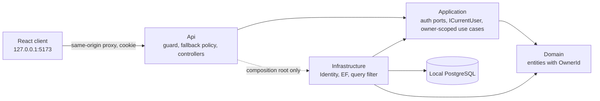
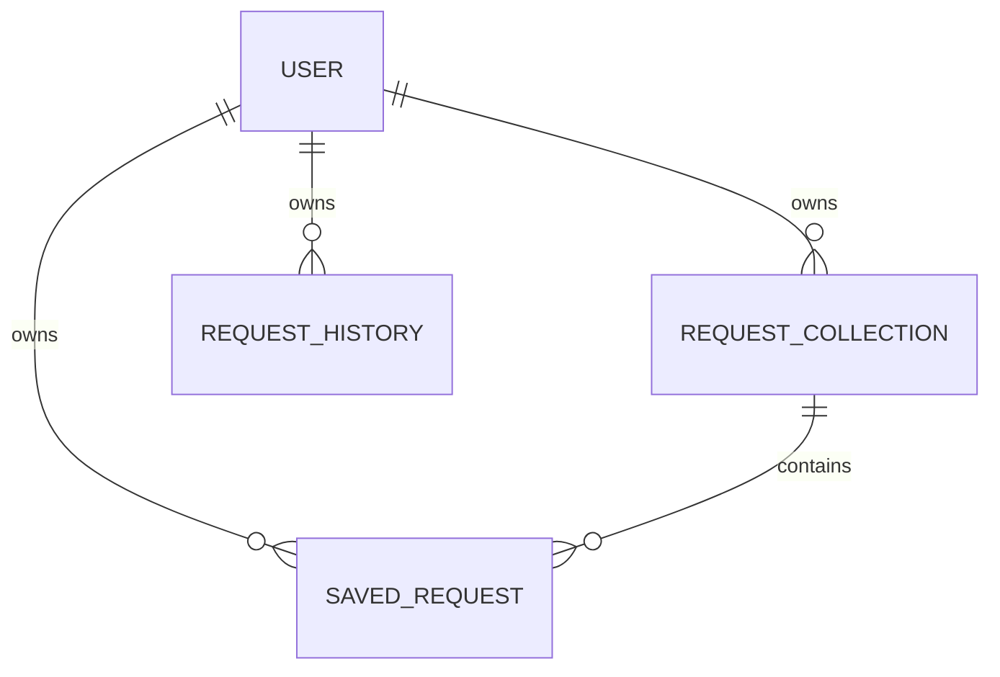

# Architecture Spine — ApiPlayground Authentication

## Design Paradigm

Clean Architecture, unchanged from the parent spine. Authentication is an additive concern: Identity technology lives in Infrastructure, Application owns the authentication and current-user ports plus every ownership rule, Domain carries only an owner id, and Api translates HTTP and cookies. Ids below are local to this spine; "Parent AD-n" refers to the backend spine.

## Inherited Invariants

| Inherited | From parent | Binds here |
| --- | --- | --- |
| Four projects with inward dependencies (AD-1) | Backend spine | Placement of every auth type (AD-1 here) |
| Application owns use cases, Api owns HTTP translation (AD-2) | Backend spine | Ownership passed through use cases (AD-5) |
| Infrastructure owns persistence and migrations (AD-3) | Backend spine | Identity stores and the wipe migration (AD-1, AD-6) |
| One guarded outbound dispatch path (AD-4) | Backend spine | Dispatch routes stay single-path and now require login (AD-4) |
| Loopback-only API with Host, Origin, and header checks (AD-6) | Backend spine | Guard scope and cookie rules (AD-3). Authentication was "not implied" there; this spine supplies it without relaxing any check |

## Invariants & Rules

### AD-1 — ASP.NET Core Identity lives only in Infrastructure [ADOPTED]

- **Binds:** FR-1–FR-7, NFR-3.
- **Prevents:** Identity or EF types leaking into Domain, Application, or controllers, and a second hand-rolled credential path.
- **Rule:** Use ASP.NET Core Identity with a user type keyed by `Guid` and no roles (`IdentityUserContext`, no role tables). The user type, `UserManager`, `SignInManager`, and password hashing are used only in Infrastructure, in the existing `PlatformDbContext` and migration history. Application declares ports for register, sign in, sign out, and `ICurrentUser` (exposing the authenticated `UserId`); Api controllers call those ports and never touch Identity types. Passwords are hashed by Identity's hasher only and never logged. Login and registration failures return generic messages that do not reveal whether an email exists.

### AD-2 — Sessions are an encrypted httpOnly cookie ticket [ADOPTED]

- **Binds:** FR-5, FR-6, NFR-2.
- **Prevents:** Ad-hoc tokens in local storage, a second session mechanism, and cookies readable by script.
- **Rule:** The single session mechanism is the Identity application cookie: `HttpOnly`, `SameSite=Strict`, sliding idle expiry of about 8 hours, no server-side session table. The local profile runs over http, so the `Secure` flag is not set there; a non-local profile must set it. Logout clears the cookie. Server-side revocation is intentionally not provided.

### AD-3 — The request guard covers every API route [ADOPTED]

- **Binds:** FR-1, FR-4, FR-6, NFR-1.
- **Prevents:** Login or registration CSRF through routes outside `/api/tracer`, and drift between guarded and unguarded groups.
- **Rule:** The Host, Origin, and `X-ApiPlayground-Request` header checks apply to all `/api/*` routes, including `/api/auth/*`, not only `/api/tracer`. CSRF protection is `SameSite=Strict` plus that guard; antiforgery tokens are not used. The browser reaches the API only through the same-origin dev proxy (`127.0.0.1:5173` forwarding to the API); direct browser calls to the API origin are not supported, because the cookie would not be sent.

### AD-4 — Every route is authenticated unless explicitly anonymous [ADOPTED]

- **Binds:** FR-10, NFR-4.
- **Prevents:** A new controller or minimal endpoint shipping unprotected.
- **Rule:** A fallback authorization policy requires an authenticated user for every endpoint, controllers and minimal endpoints alike. `[AllowAnonymous]` (or `.AllowAnonymous()`) is permitted only on register, login, and `/health`. Unauthenticated calls return 401 as ProblemDetails, never a redirect. Adding another anonymous route requires amending this rule.

### AD-5 — Ownership is explicit, with a query filter as backstop [ADOPTED]

- **Binds:** FR-8, FR-9, NFR-4.
- **Prevents:** One user reading or changing another user's collections, saved requests, or history, through UI or direct API calls.
- **Rule:** Domain entities `RequestCollectionEntity`, `SavedRequestEntity`, and `RequestHistoryEntity` each carry a required `OwnerId` (`Guid`) set at creation and never changed. The owner id is a parameter of every Application use case and persistence port method that reads or writes these records; it comes from `ICurrentUser`, never from a request body or route. Infrastructure also applies an EF global query filter on `OwnerId` as a second layer; `IgnoreQueryFilters` is not used on these entities. A record owned by someone else behaves as not found, never as forbidden.

### AD-6 — Existing data is wiped inside the generated migration [ADOPTED]

- **Binds:** FR-11.
- **Prevents:** Orphaned ownerless rows and a hand-authored migration breaking the EF snapshot.
- **Rule:** The migration is generated with `dotnet ef migrations add`. Before the non-null `OwnerId` foreign keys are added, SQL inside that generated migration clears the three data tables. `OwnerId` is never nullable, and there is no backfill. Identity tables are created in the same history stream; existing migration identities are not renamed.

### AD-7 — Isolation and default-deny are enforced by tests [ADOPTED]

- **Binds:** NFR-4, FR-9, FR-10.
- **Prevents:** Regressions where a route loses protection or a query loses its owner scope.
- **Rule:** API-host tests enumerate the registered endpoints and assert that each one rejects an anonymous call, with an explicit allowlist equal to AD-4's anonymous set. Persistence integration tests, using two users, prove that list, get, and write operations on all three entities never cross users and that a foreign id returns not found. These tests run against PostgreSQL and fail rather than skip when it is unavailable, as in Parent AD-5.



## Consistency Conventions

| Concern | Convention |
| --- | --- |
| Routes | Auth routes live under `/api/auth` (register, login, logout, current user). Controllers, not Minimal APIs, except `/health`. |
| Errors | Unauthenticated: 401 ProblemDetails. Wrong credentials or taken email: generic, non-enumerating body. Foreign record: 404. |
| Identity of caller | Read only through `ICurrentUser` in Application; never parse claims in controllers or repositories. |
| Config and secrets | Cookie and Identity options come from runtime configuration; no credentials in source control. |
| Frontend | All API calls use the same-origin proxy path and send credentials implicitly; a 401 sends the UI to the login view. |

## Stack

| Name | Version |
| --- | --- |
| Microsoft.AspNetCore.Identity.EntityFrameworkCore | 10.0.14 (latest stable on NuGet, checked 2026-11-04) |
| .NET, EF Core, Npgsql provider, PostgreSQL | As pinned in the parent backend spine |

## Structural Seed



```text
backend/src/
  ApiPlayground.Domain/          # OwnerId on the three request entities
  ApiPlayground.Application/     # Auth ports, ICurrentUser, owner-scoped ports and use cases
  ApiPlayground.Infrastructure/  # Identity user and stores, cookie options, query filter, migration
  ApiPlayground.Api/             # /api/auth controllers, guard extension, fallback policy
frontend/src/                    # Login and registration views, auth store, 401 handling
```

## Capability → Architecture Map

| Capability / Area | Lives in | Governed by |
| --- | --- | --- |
| FR-1–FR-3 Accounts | Infrastructure (Identity) behind Application ports; Api `/api/auth` | AD-1, AD-3 |
| FR-4–FR-7 Sessions and UI state | Identity cookie; Api; frontend auth store | AD-2, AD-3, AD-4 |
| FR-8–FR-9 Ownership | Domain, Application, Infrastructure query filter | AD-5, AD-7 |
| FR-10 Protected routes | Api fallback policy | AD-4, AD-7 |
| FR-11 Data reset | Generated EF migration | AD-6 |
| NFR-1–NFR-4 | Guard, cookie settings, tests | AD-2, AD-3, AD-7 |

## Deferred

- Password rules, lockout thresholds, and email format and normalization: choose within Identity options when the registration story is planned.
- Exact route names, request and response DTOs for `/api/auth`: owned by the first auth story.
- Frontend structure for the login view, store, and routing: outside this backend-focused spine; decided in the frontend story.
- Forgotten password, email verification, OAuth, roles, and server-side session revocation: out of scope; revisit only through a new PRD.
- Non-local deployment: a `Secure` cookie, HTTPS, and a different origin model are decided if the app ever leaves the local topology.
