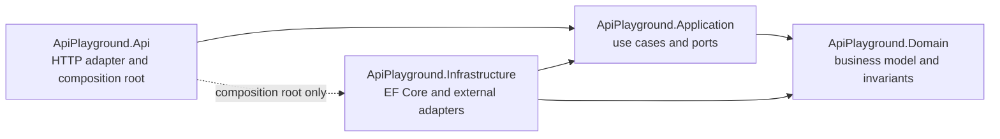
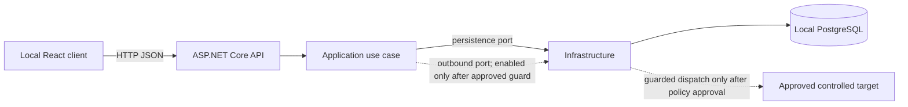

# Architecture Spine — ApiPlayground Backend

## Design Paradigm

Clean Architecture with inward compile-time dependencies. **Target state:** four runtime projects; the API is the composition root, and Infrastructure implements Application-owned ports. Story 1 remains the accepted single-project baseline. The approved architecture-boundary story is ticket 10, after Story 1 and before Story 2; it migrates the baseline, preserves the existing initial migration identity and history, and updates the solution, tests, and CI.

## Inherited Invariants

| Inherited | From parent | Binds here |
| --- | --- | --- |
| Local-first MVP with React, ASP.NET Core, PostgreSQL; public hosting and application internet access are not required | Initiative `ApiPlayground MVP` | Runtime and data topology (AD-6) |
| Owner-approved safety-first order: platform baseline → architecture boundary → outbound safety → guarded GET; no dispatch before policy and target approval | Epic `ApiPlayground MVP` | Story ordering and outbound controls (AD-3–AD-6) |
| Story 1 is complete as a single-project baseline with no request dispatch or policy decisions | Story 1 plan and ticket | Transition compatibility (AD-3, AD-4) |

## Invariants & Rules

### AD-1 — Four backend projects enforce the Clean Architecture boundary [ADOPTED]

- **Binds:** All backend stories and CAP-1–CAP-4.
- **Prevents:** Endpoint, use-case, domain, and infrastructure code being placed together or acquiring arbitrary dependencies.
- **Rule:** Runtime projects are `ApiPlayground.Domain`, `ApiPlayground.Application`, `ApiPlayground.Infrastructure`, and `ApiPlayground.Api`. Domain has no project dependencies. Application may depend only on Domain. Infrastructure may depend on Application and Domain. Api may depend on Application and Infrastructure; its Infrastructure reference is limited to composition-root/DI wiring. No other inward dependency is allowed.



### AD-2 — Application owns use cases; API owns HTTP translation [ADOPTED]

- **Binds:** CAP-1 and CAP-2; HTTP-facing portions of CAP-3 and CAP-4.
- **Prevents:** Business behavior in endpoint handlers and public HTTP payloads becoming coupled to persistence/domain implementation details.
- **Rule:** Application defines the use-case request/result contract and outcome semantics; API translates HTTP requests into that contract and maps results to HTTP status codes and DTOs. Keep one shared execution contract across Stories 3–5, with transport-independent outcome distinctions; do not expose persistence or domain implementation types as wire payloads.

### AD-3 — Infrastructure owns persistence technology [ADOPTED]

- **Binds:** PostgreSQL persistence for the MVP and all backend stories that store data.
- **Prevents:** EF Core, Npgsql, schema/migration concerns, or `DbContext` leaking into Domain, Application, or API endpoint code.
- **Rule:** `PlatformDbContext`, EF mappings, Npgsql configuration, migrations, and implementations of Application persistence ports live in Infrastructure. Ticket 10 moves the current `PlatformDbContext` and initial migration from Api while preserving migration identity/history. Application declares only use-case-focused persistence ports. Do not add a generic repository solely to wrap EF Core. API configures Infrastructure at startup but accesses persistence only through Application use cases.

### AD-4 — Outbound target requests have one guarded dispatch path [ADOPTED]

- **Binds:** CAP-1 request execution and all tests or features that can cause outbound HTTP dispatch.
- **Prevents:** A caller bypassing SSRF, timeout, redirect, or response-size enforcement by constructing its own HTTP client or using a second transport path.
- **Rule:** Application defines the outbound-execution port; Infrastructure provides the single guarded implementation. All target dispatch flows through that port and guard. API endpoints and other Infrastructure components must not create an alternate target-request path. Guard registration fails closed unless exactly one guarded adapter and an explicit approved policy are configured. Story 1 adds no request-sending endpoint and performs no dispatch; its harness verifies configured readiness only. Story 2 may dispatch only in focused tests, only to the owner-approved controlled test target, through the same guard intended for production; test-only target allowances cannot become product defaults. Product/UI dispatch remains disabled until Story 3 connects the approved guard. Tests must prove the resolved policy is the approved policy and exercise every mandatory case after the owner records policy and target approval. This rule does not select policy values.

### AD-5 — Tests remain outside runtime dependency direction [ADOPTED]

- **Binds:** Backend automated tests and the controlled-target harness.
- **Prevents:** Production assemblies depending on test code, and test setup silently weakening production dependency boundaries.
- **Rule:** Keep one backend test project for now. Tests may reference the runtime project(s) under test; no runtime project may reference the test project. Organize tests by layer/scenario. The architecture-boundary story adds automated checks for forbidden project references and direct target HTTP dispatch outside the guarded adapter. Use fakes or in-process controlled targets for unit tests; use API-host tests for HTTP wiring and PostgreSQL integration tests for persistence. Story 9 owns a distinct closeout suite and execution/reporting outside Story 2's own tests; it verifies the integrated guarded path against the settled approved cases and records the separately required human confirmation. Independence does not require a second test project or a second production transport. No test may dispatch to an unapproved external target.

### AD-6 — The runtime and data store stay local-first [ADOPTED]

- **Binds:** Backend deployment/configuration and local MVP operation.
- **Prevents:** Introducing remote hosting or infrastructure requirements contrary to the initiative boundary.
- **Rule:** The supported MVP topology is a local React client, local ASP.NET Core API, and the owner's local PostgreSQL service. Public/remote deployment and Docker are not required. Local credentials and database artifacts must not enter version control; connection settings are supplied through runtime configuration. The architecture-boundary story records how local development and CI select the API origin and provide PostgreSQL for persistence integration tests. The supported API profile binds to loopback only; LAN exposure is not the default. Before Story 3 enables a browser-triggered request endpoint, its story must select and test browser-origin/CSRF/Host protections; CORS alone is not proof of request authorization. This gate does not imply adding authentication or forbid later owner-approved LAN use with separately approved protections.

## Stack

| Name | Version |
| --- | --- |
| .NET SDK (observed locally; not repository-pinned) | 10.0.302 |
| API target framework (project-pinned; .NET 10 is LTS) | net10.0 |
| Entity Framework Core Design (current project pin; EF Core 10 is LTS) | 10.0.0 (10.0.13 latest stable on 2026-10-19) |
| Npgsql Entity Framework Core Provider (current project pin; build-verified with EF Core 10) | 10.0.0 (10.0.3 latest stable on 2026-10-19) |
| PostgreSQL (required major version; installed minor observed locally) | 17 (17.10 installed; 17.11 current supported minor on 2026-10-19) |

Version/support check (2026-10-19): [.NET 10 support policy](https://dotnet.microsoft.com/en-us/platform/support/policy/dotnet-core), [EF Core 10 release/support](https://learn.microsoft.com/en-us/ef/core/what-is-new/ef-core-10.0/whatsnew), [Npgsql EF provider docs](https://www.npgsql.org/efcore/), [EF Design NuGet](https://www.nuget.org/packages/Microsoft.EntityFrameworkCore.Design), [Npgsql provider NuGet](https://www.nuget.org/packages/Npgsql.EntityFrameworkCore.PostgreSQL), and [PostgreSQL version policy](https://www.postgresql.org/support/versioning/). The local SDK/runtime and PostgreSQL minor are observations, not repository pins. Current EF/Npgsql pins are inherited from Story 1; ticket 10 must check current patches and update compatible pins before adding EF-dependent projects.

## Structural Seed

```text
backend/
  src/
    ApiPlayground.Domain/          # Entities, value objects, domain invariants; no infrastructure references
    ApiPlayground.Application/     # Use cases, application models, persistence/outbound ports
    ApiPlayground.Infrastructure/  # EF Core/Npgsql, migrations, persistence and guarded transport adapters
    ApiPlayground.Api/             # ASP.NET Core HTTP adapter and composition root
  tests/
    ApiPlayground.Tests/           # One test project, organized by layer and scenario
frontend/                          # React client; communicates only through the HTTP API
```



## Capability → Architecture Map

| Capability / Area | Lives in | Governed by |
| --- | --- | --- |
| CAP-1 — Configure and execute a request | API adapter → Application use case → guarded Infrastructure outbound adapter | AD-1, AD-2, AD-4 |
| CAP-2 — Inspect a response | Application result → API HTTP DTO → frontend | AD-1, AD-2 |
| CAP-3 — History and replay | Application use cases and Domain model; Infrastructure persistence; replay uses guarded outbound port | AD-1, AD-3, AD-4 |
| CAP-4 — Collections | Application use cases and Domain model; Infrastructure persistence | AD-1, AD-3 |
| Backend tests and controlled target | Single backend test project, no production dependency on tests | AD-5 |
| Local runtime and PostgreSQL | Local API/UI processes and host PostgreSQL service | AD-6 |

The wire/application contract must preserve the SPEC's five methods and request inputs for CAP-1, CAP-2's status/elapsed time/headers/body, CAP-3's replay of the same request fields, and CAP-4's availability across work sessions. Story 3 owns exact model fields/types, result outcome discriminator, and mapping tests; Stories 4–7 extend the same contract according to their ticket acceptance criteria. Story 6 owns immutable attempt snapshots and persistence-failure semantics; Story 7 owns explicit collection-save mutation semantics.

## Consistency Conventions

| Concern | Convention |
| --- | --- |
| Dependency and naming | Project names follow `ApiPlayground.{Layer}`; inward references only as AD-1. Application ports are named for use-case capabilities, not EF abstractions. |
| Contracts and outcomes | One Application request/result model per execution capability; HTTP DTOs map at Api. Preserve observed target status separately from the API's transport status. Distinguish HTTP response, pre-dispatch validation/policy rejection, timeout, transport failure, and cancellation. |
| Mutation and persistence | Application use cases own state transitions; Infrastructure implements persistence. History attempts are immutable logical request snapshots; loading creates detached drafts. Collection changes require explicit save/update. Persistence failures follow the owning story's contract and never leak EF exceptions across layers. |
| Configuration and secrets | Configuration is supplied at runtime; local credentials never enter source control. CI uses non-secret test configuration and a provisioned PostgreSQL service when persistence integration tests run. |
| Local API exposure | Supported local profile binds loopback only. UI-origin, Host, and browser-trigger controls are selected and tested before a request-triggering endpoint is enabled; CORS alone is insufficient. |

## Deferred

- Architecture transition: ticket 10 in the epic ticket index is approved after Story 1 and before Story 2. It creates four projects, moves `PlatformDbContext` and migrations, updates references/CI and adds boundary checks; Story 1 remains unchanged as the accepted baseline.
- Migration continuity: support both fresh databases and existing databases already migrated by Story 1. Define canonical Infrastructure migration assembly/context/history ownership; prove existing migration IDs remain applied exactly once and the next migration is discovered/applied. Do not rename or fork the history stream without an explicit compatibility path.
- Contract ownership: Story 3 establishes the request/result contract; Stories 4–5 extend it. The contract covers GET/POST/PUT/PATCH/DELETE, URL/query/headers/JSON body; response status, elapsed time, headers and body; and distinguishes HTTP response, validation/policy rejection, timeout, transport failure and cancellation. Target response status remains distinct from the API endpoint status. Diagnostic wording describes evidence without unsupported causal claims.
- Persistence ownership: Story 6 defines the canonical immutable logical request snapshot for dispatched attempts, a detached editable draft on load/replay, stable ordering, dispatch/persist order, and its non-blocking persistence failure result. Story 7 extends the request representation for collections; a stored collection changes only through explicit save/update, with atomic creation/save and retry semantics. History items remain available across work sessions. Sensitive-header classification is an owner decision before values are persisted.
- Test environment and operations: ticket 10 owns CI PostgreSQL provisioning/connection/migration for integration tests, and local setup must continue to use the installed host PostgreSQL without requiring Docker. CI persistence tests must fail, not silently skip, when configured PostgreSQL is unavailable. Keep Story 9's distinct closeout safety suite outside Story 2's own test execution and record human confirmation.
- Browser/API threat model: Story 3 must choose and verify host/origin/request protections appropriate to the loopback browser workflow before exposing a request-triggering endpoint. CORS alone does not establish authorization; authentication is not implied by this open decision.
- Exact outbound destination allow/deny policy, SSRF/DNS-rebinding and redirect behavior, timeout and response-size thresholds, and test-target approval: must be settled before Story 2 implementation or any target dispatch.
- Concrete fields/types for cross-layer request/result models and exact routes/wire DTO names: keep one shared contract owned by Stories 3–5; do not invent external-client compatibility requirements.
- Concrete domain entities/attributes, PostgreSQL schema/indexes, transaction implementation and retention/reset policy: settle in Stories 6–7 while honoring their acceptance criteria; the UX leaves data lifecycle and retention open.
- Frontend state management, component architecture, and generated/shared client contracts: outside this backend spine; the frontend remains an HTTP consumer.
- Splitting the single test project: revisit when test volume or isolation needs make a separate project materially useful.
